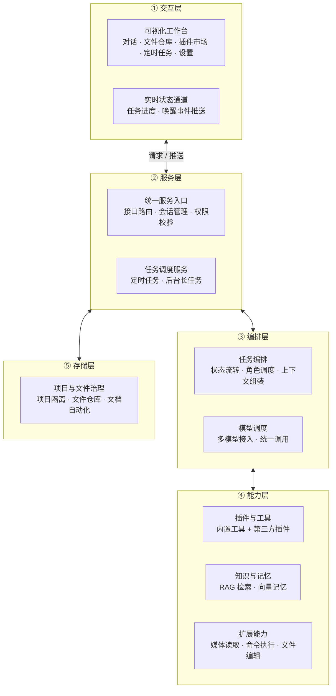
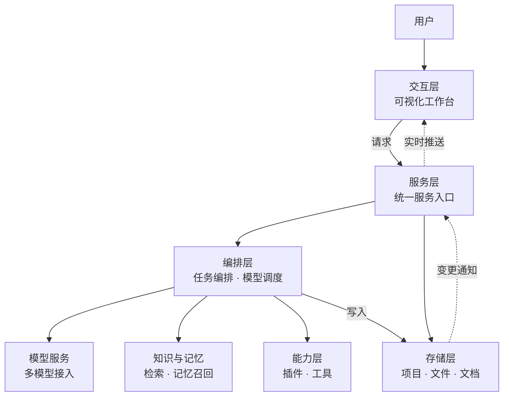

# AI智能助手 - 工作台架构说明（对外版）

> 文档类型:对外架构说明　|　版本:V2.0　|　更新日期:2026-10-14
> 依据方案:ARCH-002（对外架构说明派生）　|　执行:@文档

---

## 第 0 章 文档说明

### 0.1 文档定位

本文档面向**技术访客与集成方**，用对外口径讲清 AI智能助手工作台的**分层架构、8 大能力域、跨模块协作、扩展性与部署形态**。

它不讲"内部怎么做"（不涉及内部实现符号与工程细节），只讲"整体长什么样、能做什么、怎么协作"。

### 0.2 目标读者
技术访客、集成方与评估者、产品与管理者——分别关注系统分层与能力边界、扩展与集成方式、整体架构印象（无需深入实现细节）。

### 0.3 与另两份对外文档的关系

| 文档 | 定位 | 本文档与其关系 |
|---|---|---|
| AI智能助手功能清单 | 能力速览 | 本文档讲"功能如何分层组织"，不重复罗列功能 |
| AI智能助手项目完整报告 | 项目白皮书 | 本文档讲"架构如何搭建"，不重复版本与进度 |
| **本文档（对外架构说明）** | **架构说明** | 与上述两份形成「速览 / 白皮书 / 架构说明」三角互补 |

---

## 第 1 章 架构总览

### 1.1 分层架构图

### 1.2 八大能力域一览

| # | 能力域 | 一句话职责 | 用户可见价值 |
|---|---|---|---|
| 1 | 多模型协作 | 主控 + 多角色按槽位协作，任务派发→执行→回报→审核 | 一次需求可分派多个角色协同完成 |
| 2 | 项目文档自动化 | 项目文件变化时自动维护项目文档，文件变动 → 文档同步 | 项目文档始终与代码同步，无需手工维护 |
| 3 | 插件化扩展 | 内置工具 + 第三方插件 + 模板一键生成 + 插件市场 | 按需安装插件，能力可无限扩展 |
| 4 | 智能文件编辑 | 按锚点精准定位 + 模糊匹配的安全编辑 | 大文件改动不易错位，自动备份可回溯 |
| 5 | 可视化工作台 | Vue3 统一交互入口，实时状态推送 | 全部操作可视化，实时看到任务进展 |
| 6 | 文件仓库管理 | 文件树可视化 + 增删改查 + 噪声过滤 | 项目文件一目了然，自动屏蔽干扰项 |
| 7 | 项目记忆隔离 | 不同项目上下文互不互通 | 切换项目不串味，互不干扰 |
| 8 | 定时任务调度 | 定时任务创建 / 取消 / 删除与到点执行 | 可预约自动执行，无人值守 |

### 1.3 设计原则

1. **分层解耦**:交互 / 服务 / 编排 / 能力 / 存储五层职责清晰，任一层可独立演进；
2. **本地优先**:数据默认本地存储，检索与记忆均在本地完成，隐私不出机；
3. **能力可插拔**:核心能力与插件能力解耦，新增能力以插件形式接入，不动主干；
4. **状态可观测**:关键过程经实时通道推送到工作台，执行过程透明可见；
5. **多模型开放**:模型按槽位接入，可替换、可扩展，不绑定单一模型供应商。

---

## 第 2 章 八大能力域

> 逐条说明「职责 + 用户可见价值」，与系统 8 大核心模块一一对应。

### 2.1 多模型协作
**职责与价值**:以「主控 + 多角色」模式组织多模型协作，完成「任务派发 → 执行 → 回报 → 审核」全流程；一次需求可分派多角色协同完成，模型来源不绑定单一供应商，可按需更换。
**单轮协作顺序**:一次对话中，系统会先处理模型提出的工具操作（如读取或修改文件），待模型不再请求工具、给出最终答复后，才判断本轮是否需要把任务分派给其它角色——即「**先执行操作、后判断派发**」，两者按固定顺序进行，可同时存在于同一轮、互不冲突。
### 2.2 项目文档自动化
**职责与价值**:监听项目内文件的增删改，自动维护项目文档的文件清单与功能明细，做到「文件一变、文档即同步」；项目文档始终与工程保持一致，无需人工逐条登记。
### 2.3 插件化扩展
**职责与价值**:内置工具与第三方插件并存、统一对外提供，第三方插件动态加载并按声明校验，提供开发模板一键生成新插件、支持插件市场在线安装；用户可按需安装持续扩展能力，开发者依模板即可快速产出插件。
### 2.4 智能文件编辑
**职责与价值**:以「锚点精确定位 + 相似度模糊匹配」实现文件安全编辑，匹配失败自动扩行重试、改动前自动备份；大文件与长文档改动不易错位，误改可回溯，编辑更安心。
### 2.5 可视化工作台
**职责与价值**:Vue3 工作台作为统一人机交互入口，承载对话、文件、插件、定时任务、日志、设置等页面，经实时通道推送任务状态与唤醒事件，后端统一服务入口负责接口路由、会话管理与权限校验；全部操作可视化，任务进展实时可见、过程透明。
### 2.6 文件仓库管理
**职责与价值**:以项目仓库为根，提供文件树可视化浏览、增删改查与上传下载，内置噪声过滤规则自动屏蔽依赖目录、缓存目录等干扰项；项目文件一目了然，干扰项自动隐藏。
### 2.7 项目记忆隔离
**职责与价值**:让不同项目在助手内的历史、上下文与文件视图互不互通，支持将指定目录设为隔离或注入豁免，切换项目自动切换记忆空间；多项目并行不串味，每个项目拥有独立的 AI 记忆与上下文。
### 2.8 定时任务调度
**职责与价值**:提供定时任务的创建、更新、取消、删除与到点执行，任务随应用启停、执行结果向前端推送通知；可预约任务自动执行、实现无人值守，任务状态可视可控。
---

## 第 3 章 跨模块协作

### 3.1 全局数据流图

### 3.2 一次对话流程

1. **发起**:用户在工作台对话窗口提交需求，请求经交互层送达服务层；
2. **组装**:服务层将请求转交编排层，编排层装载项目上下文与角色设定；
3. **召回**:编排层向知识与记忆层发起检索，召回相关记忆与知识片段注入上下文；
4. **请求**:编排层经模型调度向目标模型发起调用，流式返回生成内容；
5. **工具**:若模型请求调用工具，编排层调度能力层执行，再将结果回灌模型继续生成；
6. **落盘回传**:对话与记忆同步写入存储层，结果经实时通道分片推送到前端渲染，任务状态同步更新。

### 3.3 任务派发流程

1. **判定**:主控接收需求后判定是否拆分，决定派发对象；
2. **派发**:编排层探测可用角色槽位、匹配目标角色，下发任务；
3. **执行**:次级角色各自执行并回报结果；
4. **汇总**:执行结果回传主控，主控推进状态流转；
5. **审核**:按需引入审核角色复核，输出审查结论，形成闭环。

**派发时机说明**:任务分派发生在**一次对话的收尾阶段**——系统先完成模型请求的全部操作，确认本轮不再有操作请求后，才对最终答复做一次分派判断；因此一次对话中"执行操作"与"分派任务"不会相互打断，而是**操作优先、分派随后**的固定顺序。
### 3.4 记忆召回流程

1. **写入**:对话与操作经向量化后入库，并重建索引；
2. **召回**:按查询做阈值过滤、实体抽取与打分，去冗后返回最相关片段；
3. **注入与评估**:召回片段在上下文组装时拼装进提示供模型参考，召回效果可记录评估数据用于持续调优。

---

## 第 4 章 扩展性与部署形态

### 4.1 插件体系

采用「内置工具 + 第三方插件」双层结构:内置工具开箱即用，第三方插件放入插件目录即可被自动识别加载；插件依声明式清单校验，按需懒加载或常驻运行。用户可在插件市场按需安装，无需改动主干。

### 4.2 开发模板

提供三类插件开发模板——**AIGC 生成类 / 信息采集查询类 / 本地操作类**，开发者依模板补全业务逻辑即可产出新插件，显著降低扩展门槛。

### 4.3 部署形态

- **桌面外壳**:自带图形界面，双击即用，面向个人与本机场景；
- **Web 工作台**:以浏览器访问的可视化工作台，前后端分离，便于局域网协作；
- **插件化扩展**:能力以插件按需加载，不重装即可扩展。

提供「全内置依赖版」与「全外置依赖版」两种打包形态:前者开箱即用，后者产物体积更小、依赖由用户自行安装。

### 4.4 隐私设计
配置、记忆、日志默认存于本机，检索与向量记忆全部本地执行，项目间记忆与上下文相互隔离——隐私数据不出本机、不跨项目串用。

---

*— 全文完 —*